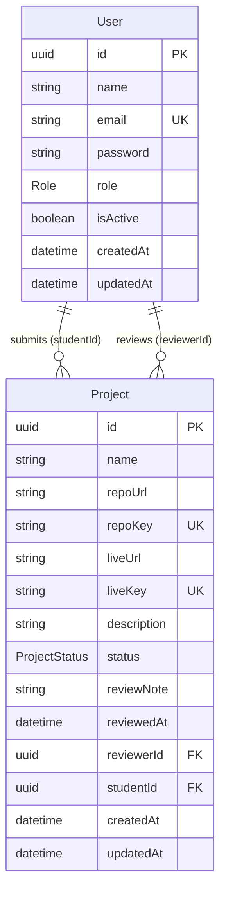

# Database Models

PostgreSQL, accessed through Prisma ORM.
Decisions behind these models are in [PLAN.md](PLAN.md). This file is the design only; nothing here has been applied to the database yet.

## 1. ER diagram



Relationships:
- One `User` (student) has many `Project`s through `studentId`.
- One `User` (mentor or admin) has many reviewed `Project`s through `reviewerId`. It stays `null` while the project is `PENDING`.

## 2. Enums

| Enum | Values | Meaning |
| --- | --- | --- |
| `Role` | `STUDENT`, `MENTOR`, `ADMIN` | `STUDENT` signs up. `MENTOR` reviews projects and is created by an admin. `ADMIN` is seeded, can review and manages mentors. |
| `ProjectStatus` | `PENDING`, `APPROVED`, `REJECTED` | New submissions start as `PENDING`. |

## 3. User

Table name: `users`

| Field | Type | Required | Constraint | Notes |
| --- | --- | --- | --- | --- |
| `id` | `String` (uuid) | yes | PK, `@default(uuid())` | uuid avoids guessable ids |
| `name` | `String` | yes | | 2-60 chars, trimmed |
| `email` | `String` | yes | **UNIQUE** | stored lowercase and trimmed |
| `password` | `String` | yes | | bcrypt hash only, never returned by the API |
| `role` | `Role` | yes | default `STUDENT` | |
| `isActive` | `Boolean` | yes | default `true` | `false` means deactivated: login is refused and existing tokens are rejected by the auth middleware (403) |
| `createdAt` | `DateTime` | yes | default `now()` | |
| `updatedAt` | `DateTime` | yes | `@updatedAt` | |

Relations: `projects Project[]` (submitted), `reviewedProjects Project[]` (reviewed).

## 4. Project

Table name: `projects`

| Field | Type | Required | Constraint | Notes |
| --- | --- | --- | --- | --- |
| `id` | `String` (uuid) | yes | PK | |
| `name` | `String` | yes | | 3-80 chars, trimmed |
| `repoUrl` | `String` | yes | | URL exactly as the student entered it (after trim), shown in the UI |
| `repoKey` | `String` | yes | **UNIQUE** | normalized repo URL, used only for duplicate detection |
| `liveUrl` | `String` | yes | | as entered |
| `liveKey` | `String` | yes | **UNIQUE** | normalized live URL, used only for duplicate detection |
| `description` | `String` | yes | | 20-1000 chars, trimmed |
| `status` | `ProjectStatus` | yes | default `PENDING` | |
| `reviewNote` | `String?` | no | | required by the API when rejecting (min 5 chars), optional when approving |
| `reviewedAt` | `DateTime?` | no | | set when an admin approves or rejects |
| `reviewerId` | `String?` | no | FK -> `users.id`, `onDelete: SetNull` | mentor or admin who made the last decision |
| `studentId` | `String` | yes | FK -> `users.id`, `onDelete: Restrict` | owner of the submission |
| `createdAt` | `DateTime` | yes | default `now()` | |
| `updatedAt` | `DateTime` | yes | `@updatedAt` | |

### Indexes

| Index | Why |
| --- | --- |
| `UNIQUE(repoKey)` | blocks the same repo being submitted twice, even in a race between two requests |
| `UNIQUE(liveKey)` | blocks the same live link being submitted twice |
| `(status, createdAt)` | admin table: filter by status, newest first, paginated |
| `(studentId, createdAt)` | student's "My submissions" list |

### Duplicate keys (`repoKey`, `liveKey`)

Normalization rules: lowercase the host, remove `www.`, remove a trailing `.git`, remove trailing slashes, drop the protocol, query string and hash.

| Input | Stored key |
| --- | --- |
| `https://GitHub.com/Belal/My-App/` | `github.com/belal/my-app` |
| `https://www.github.com/belal/my-app.git` | `github.com/belal/my-app` |
| `https://github.com/belal/my-app?tab=readme#top` | `github.com/belal/my-app` |
| `https://my-app.vercel.app/` | `my-app.vercel.app` |
| `http://my-app.vercel.app` | `my-app.vercel.app` |

All of the first three give the same key, so the second and third submissions are rejected with `409`.

## 5. Prisma schema (design draft)

Not applied yet. Copy into `server/prisma/schema.prisma` during Phase 1.

```prisma
generator client {
  provider = "prisma-client-js"
}

datasource db {
  provider = "postgresql"
  url      = env("DATABASE_URL")
}

enum Role {
  STUDENT
  MENTOR
  ADMIN
}

enum ProjectStatus {
  PENDING
  APPROVED
  REJECTED
}

model User {
  id        String   @id @default(uuid())
  name      String
  email     String   @unique
  password  String
  role      Role     @default(STUDENT)
  isActive  Boolean  @default(true)
  createdAt DateTime @default(now())
  updatedAt DateTime @updatedAt

  projects         Project[] @relation("ProjectStudent")
  reviewedProjects Project[] @relation("ProjectReviewer")

  @@map("users")
}

model Project {
  id          String        @id @default(uuid())
  name        String
  repoUrl     String
  repoKey     String        @unique
  liveUrl     String
  liveKey     String        @unique
  description String
  status      ProjectStatus @default(PENDING)
  reviewNote  String?
  reviewedAt  DateTime?
  createdAt   DateTime      @default(now())
  updatedAt   DateTime      @updatedAt

  studentId  String
  student    User    @relation("ProjectStudent", fields: [studentId], references: [id], onDelete: Restrict)
  reviewerId String?
  reviewer   User?   @relation("ProjectReviewer", fields: [reviewerId], references: [id], onDelete: SetNull)

  @@index([status, createdAt])
  @@index([studentId, createdAt])
  @@map("projects")
}
```

## 6. Main queries these models serve

| Use case | Query shape | Index used |
| --- | --- | --- |
| Admin list with filter | `where status = ? order by createdAt desc limit/offset` plus `count` | `(status, createdAt)` |
| Admin search | `name`/`repoUrl` contains text, or student name/email contains text (case-insensitive) | none; fine at this scale |
| Stats | `groupBy status` with `_count` | `(status, createdAt)` |
| Student list | `where studentId = ? order by createdAt desc` | `(studentId, createdAt)` |
| Duplicate check | `where repoKey = ? or liveKey = ?` | the two unique indexes |
| Login | `where email = ?` and `isActive = true` | unique `email` |

## 7. Seed data

| Record | Source |
| --- | --- |
| One `ADMIN` user | `ADMIN_NAME`, `ADMIN_EMAIL`, `ADMIN_PASSWORD` from `server/.env`; the seed is idempotent (upsert by email) |
| One demo `MENTOR` (optional) | `MENTOR_EMAIL`, `MENTOR_PASSWORD` from env, so the review flow can be tried before using the admin's "Add mentor" form |
| Optional demo students and projects in every status | only if we want a populated dashboard for the demo; decide in Phase 1 |

## 8. Design notes
- `repoUrl`/`liveUrl` keep the original value for display; `repoKey`/`liveKey` exist only for uniqueness. This avoids showing the student a mangled URL.
- Duplicates are unique across all students on purpose: one repo equals one submission.
- Student rows use `onDelete: Restrict` so a student with submissions cannot be deleted by accident. There is no delete feature right now.
- A re-review overwrites `status`, `reviewNote`, `reviewedAt` and `reviewerId`. There is no history table; add a `ProjectReview` log table later if an audit trail is needed.
- Not in scope: refresh tokens, email verification, password reset tokens, soft delete.
